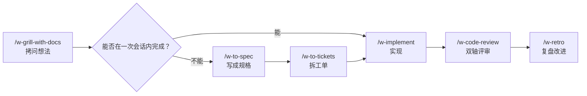

# skills

27 个面向工程实战的 agent 技能，正文为中文，全部以 `w-` 开头。派生自 [mattpocock/skills](https://github.com/mattpocock/skills)，译文规范见 [docs/TRANSLATION.md](docs/TRANSLATION.md)。

## 安装

通过 APM：

```bash
apm install wxxxcxx/skills
```

只取其中一个：

```bash
apm install wxxxcxx/skills --skill w-tdd
```

不装 APM 时，直接复制文件即可：

```bash
git clone https://github.com/wxxxcxx/skills && cd skills
cp -r engineering/.apm/skills/w-* general/.apm/skills/w-* ~/.claude/skills/
```

Codex、Copilot 等其他 harness，把目标目录换成对应的 skills 路径。

## 开始使用

不知道该用哪个技能时，先问路由器：

```
/w-help
```

说明你要做的事，它给出路径与要调用的技能。第一次跑工程流程之前，先执行一次 `/w-setup-project`，配置 issue tracker、分诊标签与文档布局；此后各技能都读这几份配置。

## 主流程

多数工作走这条线：一个想法进来，交付出去。



`/w-implement` 内部驱动 `/w-tdd`（一次一个红-绿切片）与 `/w-code-review`（规范 + 规格两条轴）。想一次跑完整份 spec、由多个子代理并行实现，用 `/w-implement-spec` 代替逐张 `/w-implement`。

## 另外两个入口

**有东西坏了**：

```
/w-diagnosing-bugs
```

先建立能对这个缺陷变红的反馈回路，再谈假设。修完在同一次会话跑 `/w-retro`。

**大而模糊、一次会话装不下**：

```
/w-wayfinder
```

在 issue tracker 上铺一张决策地图，逐张解决，直到路清晰，再交给 `/w-to-spec` 进入主流程。

## 独立使用

```
/w-grill-me           连环追问，不留记录
/w-prototype          一次性代码验证设计问题
/w-research           后台调研，产出带引用的 Markdown
/w-handoff            把当前对话压缩成交接文档
/w-triage             让 issue 与 PR 走完分诊状态机
/w-teach              跨会话学一个概念
/w-wait-what          没听懂，让它重讲一遍
```

完整清单与各自适用场景，见 `/w-help` 的路由表。

## 前提

需要 harness 支持斜杠命令与 Skill 工具（Claude Code、Codex、Copilot 等）。技能假设仓库存在 issue tracker，默认 GitHub Issues，也可用本地 Markdown，由 `/w-setup-project` 指定。
