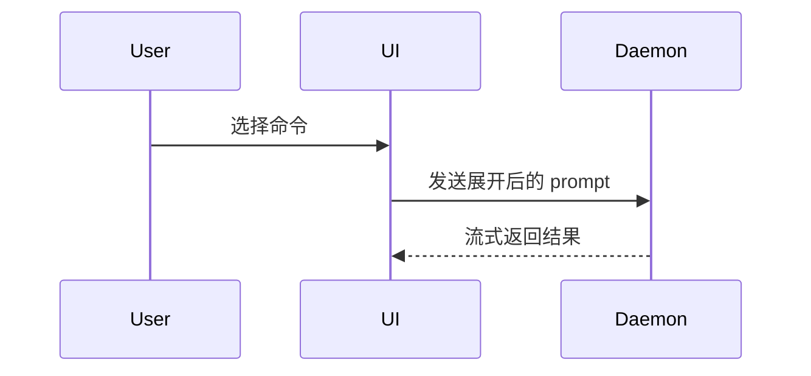

用这个模板写 PR 正文：

```markdown
## 概要

<示意图、diff 草图或目录树>

## 证据

- **改动前：** <截图 / 输出 / 失败的测试运行>
  **改动后：** <截图 / 输出 / 通过的测试运行>

## 合并风险

**门类型：** <单向门 / 双向门>

<可选：说明>

**影响半径：** <一个词>

<可选：合并后可能的连锁影响>
```

## 各段怎么写

跳过所有客套开场，文字尽量短。用 `GLOSSARY.md` 里的业务语言。

### 概要

挑**最小的那个视图**，让关键点一眼可见。

- 逻辑或算法用伪代码：

```text
on(save)
    如果内容没变
        返回缓存结果
    写入新内容
    返回最新结果
```

- 运行时控制流用调用树：

```text
submitForm
    createSession
        persistPrompt
        launchAgent
    navigateToSession
```

- UI 结构用组件树，带上关键的 state 与模块边界：

```text
<SessionPage> (apps/example/src/routes/session.tsx)
    useSessionEvents()
    <SessionToolbar>
        <RunSkillButton> (packages/ui)
```

- 文件职责或大范围重构用浅层目录树：

```text
src/
├── commands/       # 解析用户动作
├── sessions/       # 持有会话状态
└── transport/      # 发请求
```

- 组件交互、控制流、数据流用 Mermaid：



- 当重点是"改了什么"、而整体结构已经存在时，用 `diff`，并让 diff 的形状匹配主题。

组件改动：

```diff
 <SessionPage>
   useSessionEvents()
   <SessionToolbar>
+    <RunSkillButton />
   <SessionTimeline>
+    <SkillResultCard />
```

目录结构改动：

```diff
 src/
 ├── commands/
+│   └── show-me.ts       # 展开斜杠命令
 ├── sessions/
-└── transport.ts
+└── transport/
+    ├── client.ts
+    └── stream.ts
```

调用树变化：

```diff
 submitForm
   createSession
     persistPrompt
+    expandSkillMention
     launchAgent
-  navigateToSession
+  navigateToSession
+    subscribeToEvents
```

状态或控制流变化：

```diff
 on(save)
-  write content
+  if content is unchanged
+    return cached result
+  write new content
+  invalidate cache
```

- 当大部分内容都是新的、省略上下文会看不出归属或顺序、或者用户需要一个可直接复制的目标形态时，给完整代码块：

```ts
function expandSkill(command: string): string {
  const skillName = command.slice(1);
  return `use the ${skillName} skill`;
}
```

#### 原则

每个图/代码块都紧挨着它支撑的那句话。只保留回答当前问题、或支撑当前讨论选项所需的调用、文件、props、状态与边界。

这些形式可以只用一种，也可以叠加，但**很少需要全用**。自己判断，别把读者淹了。

### 证据

给出"这次改动确实生效"的硬证据，并展示前后对比。

**截图是 S 级**——环境支持、且改动是视觉层面时首选。

**可执行证据是 A 级**：测试结果、控制台输出。用伪代码说明"哪个测试从失败变通过"。

### 合并风险

说明这是**单向门**还是**双向门**：双向门可以走回来，单向门不行。容易回滚的 PR 风险更低；涉及破坏性操作、或难以撤销的决策，属于单向门。

**影响半径**是这次改动可能波及的范围——布局位移、下游使用者被破坏、移动端适配等，尽量都想到。
